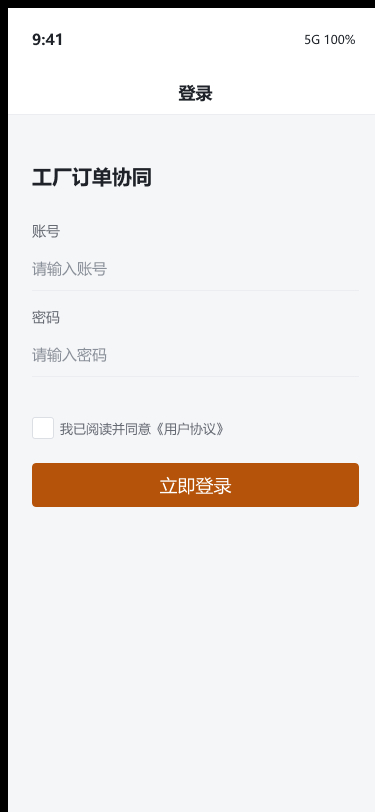
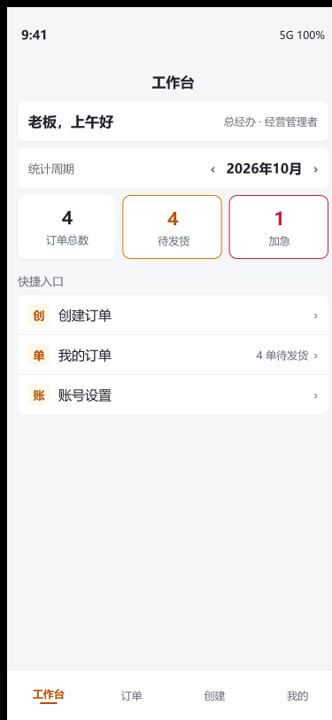
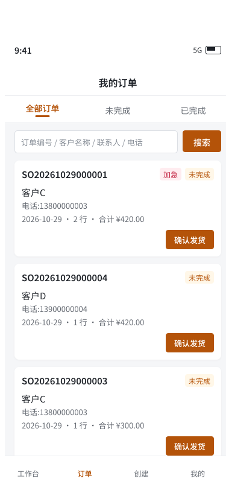
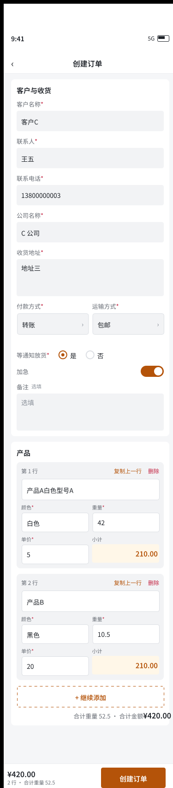
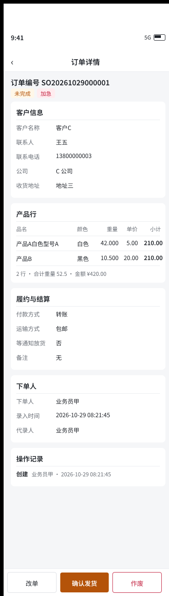
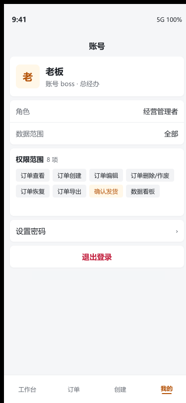
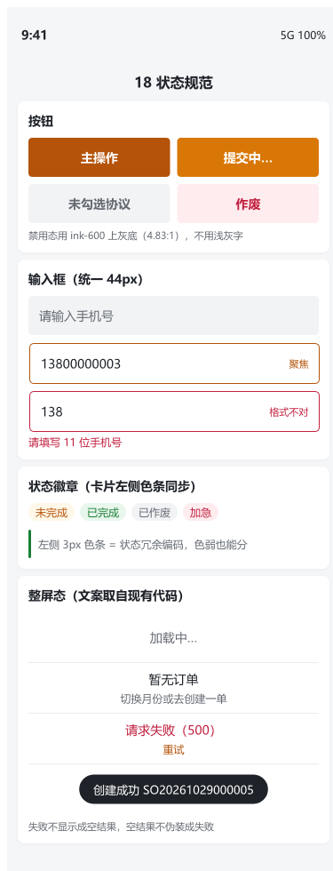

# 工厂订单协同系统 · 小程序 + Web 后台

> 业务员在微信里报一句「产品A 白色 42 公斤 单价 5 块」，助理手抄进 Excel，发货时再翻聊天记录核对——**这张单算谁的、现在该谁动、动过没有**，三个问题一个都答不上来。这套系统就是来答这三句话的。

**⚠️ 本仓库不含源代码。** 这里是产品说明 + 界面预览 + 方案节选，用于让需求方看懂它到底做什么、边界在哪。源码不开源、不托管在公开仓库；如需评估请走文末「交付与授权方式」。

一张单的接力：

```
录入员 建单  →  主管 复核 / 改单 / 作废  →  发货执行 确认发货  →  状态锁死，只能查，不能改
   未完成                    未完成                       已完成
```

---

## 1. 它替掉的是什么

| 现在的做法 | 这套系统里的落点 |
|---|---|
| Excel 里手算小计、抄错单价 | 合计金额**由服务端按 重量 × 单价 重算**，客户端传来的金额不作数 |
| 谁都能改单，发货靠打电话问 | 录入与发货**分成两个角色**，只有发货执行岗能确认发货 |
| 「已发货」「已取消」在不同人嘴里含义不一致 | 状态**只有三态**：未完成 / 已完成 / 已作废，且已完成之后一律拒改拒删 |
| 代录的单算谁的，事后说不清 | 归属按创建人算，代录人只作业务留痕，两者分开记 |
| 想改流程口径要重新发小程序版本 | 页面按钮、底部导航槽位**全部按权限点渲染，不看角色名**——改权限不用发版，也就绕开了小程序审核 |

## 2. 它不是什么

不做进销存、不做库存扣减、不做财务对账、不做物流跟踪、不做 WMS。
它管的是一段很窄的路：**订单从被录入，到被发货，到不可再改**。想把这些都装进一个系统，请找 ERP 厂商。

## 3. 角色与「打开应用能走到哪一屏」

内置 7 个角色、10 个权限点、3 档数据范围（本人 / 本部门及下属 / 全部）。

| 角色 | 数据范围 | 建单 | 未完成单上能做什么 | 已完成单上能做什么 |
|---|---|---|---|---|
| 录入员 | 只看本人 | ✅ | 只能提交，提交后这单就交出去了 | 只读 |
| 主管 | 本部门及下属 | ✅ | 改单、作废 | 只读 |
| 发货执行 | 全部 | ❌ | **确认发货**（全系统唯一能推进状态的入口） | 只读 |
| 经营管理者 | 全部 | ✅ | 改单、作废、确认发货 | 只读归档 |
| 生产查看 | 全部 | ❌ | 只读 | 只读 |
| 发货协同 | 全部 | ❌ | 只读 | 只读 |
| 后台管理员 | 全部 | 后台代录 | 后台侧全量：恢复、导出、留痕查询 | 只读 |

这张表不是纸上推的：用 7 个真实账号各登录一次，逐个记录数据范围、列表张数、卡片上有没有快钮、详情页底部动作条下发了哪些动作、对已发货单发起改/删拿到的返回码，跑完固化成断言。

**跑出来两处真问题，都改了**——这类问题只有按角色逐屏走一遍才会暴露，对着权限表看不出来：

1. 服务端把「导出」动作下发给小程序，而小程序 7 个屏里没有任何导出入口（导出只在 Web 后台）→ 用户点了却没地方用。
2. 三个零动作角色（录入员 / 生产查看 / 发货协同）屏底挂着一条 38px 高的**空白操作条** → 现在动作列表为空时连容器一起不渲染。

顺带量到一处接口行为：已发货的单，**有权限的人**改它返回 409，**没权限的人**改它返回 403——「状态不允许」和「身份不允许」是两个不同的答案，提示文案要分开写。

## 4. 界面预览

以下画板与已实现的小程序端是同一套页面结构与按钮文案（逐字取自实现代码），配色与细节以最终实现为准。表内的客户、电话、金额均为**示意数据**。

| 登录 | 工作台 | 订单列表 |
|---|---|---|
|  |  |  |

| 创建订单（含改单态） | 订单详情 | 我的 |
|---|---|---|
|  |  |  |

**异常与边界态**同样有设计：加载骨架、空列表、取数失败、无权限、字段校验失败、状态徽章与对比度。
取数失败时**不会伪装成「本月 0 张」**——错误原样显示在那块区域上。「这个月 0 张」和「你没权限看」不长同一个样子。



## 5. 几条能当场验证的行为

不是「我们重视质量」这种话，是可以在你方服务器上复点的：

- **幂等防重复发货。** 确认发货要求带幂等键，缺键直接 400 不静默放过；同一个键重放，返回**同一个发货单号**。发货员连点两次只会发出一单。
- **已发货单锁得死死的。** 对已完成订单发起修改或删除，返回 409，文案是「此订单已发货，不可删除！」。
- **越权不泄露存在性。** 不在你数据范围内的订单，详情接口返回 404 而不是 403——不告诉你「有这张单但你不能看」。
- **校验只有一份定义。** 小程序建单、小程序改单、后台代录、后台改单四个入口共用同一套规则与 21 条中文提示，不会出现「后台存得进去、小程序读出来对不上」。
- **换皮肤改一个文件。** 48 条视觉令牌收在一处变量表，配套一个复点器脚本保证页面里不存在字面色值。
- **登录不暴露账号有效性。** 「账号不存在」与「密码错误」是同一句文案。
- **删除是软删 + 留痕。** 每次建单、改单、作废、发货都留一条操作记录，后台有只读留痕页，管理员可恢复。

## 6. 技术栈与工程规模

| 层 | 选型 |
|---|---|
| 小程序端 | uni-app（Vue 3.4 + TypeScript，Vite 5）· 7 个页面 · 出包目标 `mp-weixin` |
| Web 管理后台 | Laravel 13 + Filament 5.11 · 11 个资源页 + 看板 + 待发货池 |
| 后端 | PHP 8.3 + Laravel 13，与后台同应用部署 · Sanctum 令牌 · 28 个接口端点 |
| 权限 | spatie/laravel-permission + Filament Shield，权限位可在后台页面里直接勾选调整 |
| 数据库 | MySQL 8.0 · 11 张业务表 + 5 张权限表，DDL 有一份独立基线文件 |
| 测试 | 134 例 / 1,030 条断言（接口契约 + 权限矩阵 + 角色流程 + 后台样式） |

## 7. 交付与授权方式

| 方式 | 给什么 | 适合谁 |
|---|---|---|
| **私有化部署** | 部署到你方服务器（自建或你名下的云主机），数据不出你方内网；含缺陷维护与远程支持，期限与范围按合同 | 大多数工厂客户 |
| **源码授权 / OEM** | 单独洽谈，签协议后交付 | 有自己运维的集团客户、想二次开发的软件公司 |
| **先试用** | 预约一次远程演示 | 还在比较的阶段 |

价格、工期不在这里公开——需求方差异太大，公开报价对双方都没用。**请按你的实际单量、角色人数、是否需要对接现有 ERP 来谈。**

## 8. 需求方常见关切

见 [docs/常见问题.md](docs/常见问题.md)：什么行业最贴合、数据在谁手上、能不能改字段、服务器要什么配置、和现有 ERP/进销存怎么共存、已发货的单录错了怎么办。

方法论（怎么把一份「只画了正常路径」的原型变成可开工的规格，口径分歧是怎么逐条裁定、逐条结案的）见 [docs/需求与裁定方法.md](docs/需求与裁定方法.md)。

## 9. 联系方式

有意向或有疑问，请在本仓库 [开一个 Issue](issues/new)。
带上**行业 + 日均单量 + 几个人录单 + 现在用什么记**，我按你的实际情况给方案和报价，不回模板。

不方便公开说的（比如报价、源码授权条款），Issue 里说一句「希望私聊」，我看到会私信你。

<!-- 若要把微信/手机号直接放上来，替换本节即可；仓库转 public 前请再确认这一栏你愿意对全世界可见。 -->

## 10. 许可

本仓库内容为商业产品说明，**保留所有权利**（[LICENSE](LICENSE)）。仓库中的截图与文字说明不代表授予任何软件使用权或源代码访问权。

---

<details>
<summary>English</summary>

**Factory Order Collaboration System** — WeChat Mini Program + web admin panel.
Sales create orders, supervisors edit or void them, one dedicated role confirms the shipment, and once an order is shipped it is locked against edits and deletes. Seven built-in roles, ten permission points and three data-scope levels; every button and tab-bar slot renders from server-computed permissions rather than role names, so policy changes need no app release.
This repository contains **no source code** — product description, UI boards and specification excerpts only. Source licensing and private deployment are available on request.

</details>
